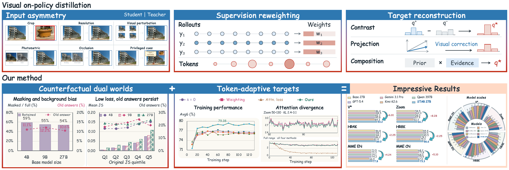
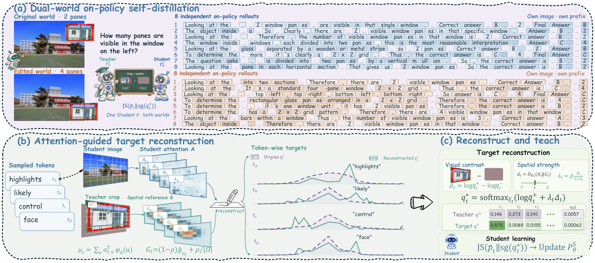

# STAR: Counterfactual Dual-World Rollouts and Spatial Target Adaptive Reconstruction for Visual On-Policy Distillation

[](https://huggingface.co/collections/Yizou/star)
[](https://huggingface.co/datasets/Yizou/STAR-6K)
[](LICENSE)
· [简体中文](README_zh.md)

Official implementation of STAR. Run a released vision-language model on an image, train a Qwen3.5 student on STAR-6K, or reproduce the six-benchmark evaluation.

[](assets/figures/figure-1.pdf)

*Figure 1. How much accuracy survives when local evidence is masked? The figure also shows how performance changes with training and model size.*

---

## 📑 Contents

- [Models and data](#-models-and-data)
- [Quick start](#-quick-start)
- [Project structure](#-project-structure)
- [Train STAR](#-train-star)
- [Evaluation](#-evaluation)
- [Citation](#-citation) · [Acknowledgments](#-acknowledgments)

## 📦 Models and data

Each Hugging Face checkpoint contains the full BF16 student weights, tokenizer, image processor and chat template. Scores are accuracies (%). Avg6 gives equal weight to the six benchmarks listed under [Evaluation](#-evaluation).

| Base model | Released checkpoint | Base Avg6 | STAR Avg6 |
|---|---|---:|---:|
| Qwen3.5-4B | [STAR-4B](https://huggingface.co/Yizou/STAR-4B) | 71.27 | **79.31** |
| Qwen3.5-9B | [STAR-9B](https://huggingface.co/Yizou/STAR-9B) | 74.01 | **78.91** |
| Qwen3.5-27B | [STAR-27B](https://huggingface.co/Yizou/STAR-27B) | 76.28 | **81.10** |

**STAR-6K** contains 6,176 pairs. Each row stores two full images (`image_original`, `image_edited`), their evidence crops (`crop_original`, `crop_edited`) and the correct answer to the same question in each image. [Download STAR-6K](https://huggingface.co/datasets/Yizou/STAR-6K) · [Data format](docs/data.md)

## 🚀 Quick start

### Install on NVIDIA H20

Use Linux and Python 3.10 or later. Set up the CUDA packages for your GPU, then install the repository from its root.

| Component | H20 environment |
|---|---|
| PyTorch / vLLM / Transformers | 2.10.x / 0.17.1 / 5.5.3 |
| GPU kernels | CUDA Triton, FlashAttention 2, FLA 0.4.2 (`fla-core` and `flash-linear-attention`), `causal-conv1d` 1.6.1 |
| Training framework | The bundled `verl` 0.7.0.dev0 includes the STAR training code |

```bash
python -m pip install -r requirements-h20.txt
python -m pip install -r requirements-eval.txt
python -m pip install -e . --no-deps
```

### Try a released model

Save STAR-4B in `/tmp/models/STAR-4B`. This example creates its own input image and asks the model one question. For your own image, change `--image` and `--question`.

```bash
python - <<'PY'
from PIL import Image

Image.new("RGB", (224, 224), "red").save("/tmp/star-demo.png")
PY

python scripts/infer.py \
  --model /tmp/models/STAR-4B \
  --image /tmp/star-demo.png \
  --question "What color is the square?"
```

The student takes an image and a question. The script uses greedy decoding with thinking disabled and a limit of 8,192 new tokens.

## 📁 Project structure

```text
STAR/
├── configs/                    Training recipes for 4B, 9B and 27B
├── scripts/
│   ├── prepare_star6k.py       Convert released Parquet files to training inputs
│   ├── train.sh                Launch training with Ray
│   ├── merge_checkpoint.sh     Merge FSDP shards into a Hugging Face model
│   ├── infer.py                Answer a question about one image
│   └── evaluate.py             Run benchmarks and resume incomplete results
├── verl/                       Training framework and STAR implementation
├── chat_templates/             Training chat template
├── evaluation/                 Benchmark preparation, inference and judging
├── docs/                       Data format, implementation and evaluation protocol
└── assets/figures/             Paper figures as PNG and PDF
```

The implementation guide links each part of STAR to its source file. [Implementation guide](docs/implementation.md)

## 🔧 Train STAR

[](assets/figures/figure-2.pdf)

*Figure 2. The question stays the same while the window-pane count changes. Each full image is paired with its own evidence crop.*

### Prepare the training data

Download STAR-6K to `/tmp/datasets/STAR-6K`. Data preparation runs on CPU with `pyarrow` and `pillow`.

```bash
python scripts/prepare_star6k.py \
  --source /tmp/datasets/STAR-6K \
  --output /tmp/star6k-prepared
```

The importer reads `data/train-*.parquet`, or a single Parquet file for a small run. It writes `worlds.parquet`, `preparation.json` and the four original image byte strings per pair under `media/<pair-id>/`. Place the prepared data and matching **Base** model at the same absolute paths on every training node.

### Launch training

The default run uses eight nodes with eight GPUs each. Each update uses 96 pairs and samples eight answers per image, with temperature 1. The teacher and student start from the same Base model and only the student is updated. Training runs for 130 updates and saves a checkpoint every 10. The prompt and answer limits are 8,192 and 1,024 tokens.

Set these paths on the head node. The last command prints the resolved 4B configuration.

```bash
export STAR_MODEL=/tmp/models/Qwen3.5-4B
export STAR_TRAIN_FILE=/tmp/star6k-prepared/worlds.parquet
export STAR_OUTPUT=/tmp/star-checkpoints/4b
export STAR_RUN=star-4b

bash scripts/train.sh 4b --cfg job --resolve
```

Use the same code and environment on every node. Set `HEAD_IP` to the reachable IP of the head node in each shell that uses it.

```bash
# On the head node
ray start --head --port=6379 --num-gpus=8
```

```bash
# On each of the other seven nodes
ray start --address="$HEAD_IP:6379" --num-gpus=8
```

```bash
# Once, on the head node
export RAY_ADDRESS="$HEAD_IP:6379"
bash scripts/train.sh 4b
```

For the other sizes, use `9b` or `27b` and select the matching Base model and output directory.

<details>
<summary>Run 9B on 32 H20 GPUs</summary>

Start Ray on one head and three worker nodes with eight H20 GPUs each. On the head, use the same prepared data and Ray address as above.

```bash
export STAR_MODEL=/tmp/models/Qwen3.5-9B
export STAR_OUTPUT=/tmp/star-checkpoints/9b-h20
export STAR_RUN=star-9b-h20
bash scripts/train.sh 9b trainer.nnodes=4 trainer.n_gpus_per_node=8
```

</details>

<details>
<summary>Save, resume and export a checkpoint</summary>

Checkpoints are written to `STAR_OUTPUT/global_step_N/`. Each node holds its own FSDP shards. The head also holds the dataloader state and Hugging Face metadata. **Collect every file for the step in one directory before releasing the nodes.**

To resume, restore the complete checkpoint and training data to their local paths. Use the same recipe and training world size.

```bash
bash scripts/train.sh 4b \
  trainer.resume_mode=resume_path \
  trainer.resume_from_path=/tmp/star-checkpoints/4b/global_step_50
```

To export a collected checkpoint for inference, supply a fresh output directory.

```bash
bash scripts/merge_checkpoint.sh \
  /tmp/star-checkpoints/4b/global_step_60 /tmp/models/STAR-4B-step60
```

</details>

## 🧪 Evaluation

| Benchmark | Questions |
|---|---:|
| VStar | 191 |
| ZoomBench | 845 |
| HRBench-4K | 800 |
| HRBench-8K | 800 |
| MME-RealWorld EN | 23,609 |
| MME-RealWorld CN | 5,917 |

Avg6 is the unweighted mean of the six benchmark accuracies. Prepare the benchmark JSON files with local image paths. [Evaluation protocol and input filenames](docs/evaluation.md)

**Generate answers.** Start the student server, then run the evaluator in a second terminal. The student uses temperature 0, seed 42 and up to 8,192 output tokens with thinking disabled.

```bash
vllm serve /tmp/models/STAR-4B \
  --served-model-name STAR --port 8000 --dtype bfloat16 \
  --tensor-parallel-size 1 --max-model-len 16384
```

```bash
python scripts/evaluate.py --data /tmp/benchmarks --output /tmp/star-eval/4b \
  --model STAR --phase answers
```

**Score answers.** Stop the student server and start the local GPT-OSS-120B judge. Scoring applies deterministic rules first and sends unresolved answers to the judge. This example uses six GPUs and a judge output limit of 2,048 tokens.

```bash
vllm serve /tmp/models/gpt-oss-120b \
  --served-model-name openai/gpt-oss-120b --port 8900 \
  --tensor-parallel-size 2 --pipeline-parallel-size 3 --max-model-len 16384
```

```bash
# In a second terminal, reuse the same output directory
python scripts/evaluate.py --data /tmp/benchmarks --output /tmp/star-eval/4b \
  --phase judge
```

The evaluator records failed items and continues through the remaining benchmarks. Rerunning reuses valid outputs. If answers or judge labels are still missing or invalid, it exits with a nonzero status and lists those items in `summary.json`. It reports complete averages once every item is resolved.

## 🎓 Citation

```bibtex
@misc{zou2026star,
  title  = {{STAR}: Counterfactual Dual-World Rollouts and Spatial Target Adaptive Reconstruction for Visual On-Policy Distillation},
  author = {Yi Zou and Zhuang Yan and Yudong Zhang and Xu Wang and Yang Wang},
  year   = {2026}
}
```

## 🙏 Acknowledgments

- **Training and inference.** We adapted the Vision-OPD training and evaluation code, use verl for distributed training, fine-tune Qwen3.5 models and sample training responses with vLLM. [Vision-OPD](https://github.com/VisionOPD/Vision-OPD) · [verl](https://github.com/verl-project/verl) · [Qwen3.5](https://huggingface.co/collections/Qwen/qwen35) · [vLLM](https://github.com/vllm-project/vllm)
- **Training data.** We thank the Vision-OPD team for the original images, questions and evidence crops. We created the locally edited counterparts and verified the answers for each pair. [Vision-OPD-6K](https://huggingface.co/datasets/yuanqianhao/Vision-OPD-6K)
- **Evaluation data.** We thank the benchmark authors. The choice of main benchmarks follows Vision-OPD and V-Zero. [V-Zero](https://github.com/eVI-group-SCU/V-Zero) · [V\* Bench](https://github.com/penghao-wu/vstar) · [ZoomBench](https://huggingface.co/datasets/inclusionAI/ZoomBench) · [HR-Bench](https://huggingface.co/datasets/DreamMr/HR-Bench) · [MME-RealWorld](https://github.com/MME-Benchmarks/MME-RealWorld)
- **Generalization benchmarks in the paper.** [DynaMath](https://github.com/DynaMath/DynaMath) · [LogicVista](https://github.com/Yijia-Xiao/LogicVista) · [CV-Bench](https://huggingface.co/datasets/nyu-visionx/CV-Bench)

[Code license](LICENSE) · [Upstream notices](NOTICE)
