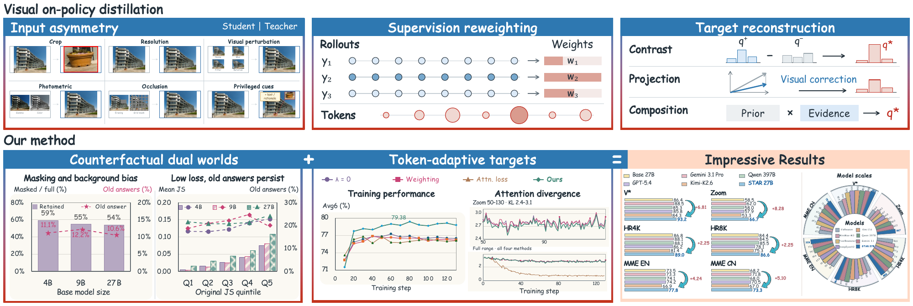
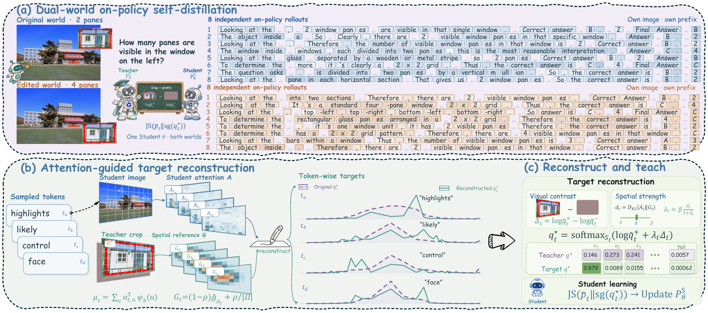

# STAR: Counterfactual Dual-World Rollouts and Spatial Target Adaptive Reconstruction for Visual On-Policy Distillation

[](https://huggingface.co/collections/Yizou/star)
[](https://huggingface.co/datasets/Yizou/STAR-6K)
[](LICENSE)
· [English](README.md)

这是 STAR 的官方实现。你可以用发布的模型做单图问答，用 STAR-6K 训练 Qwen3.5 Student，也可以复现论文的六项主评测。

[](assets/figures/figure-1.pdf)

*图 1　遮住局部证据后，模型还能答对多少？图中也给出了不同训练步数和模型规模下的评测结果。*

---

## 📑 目录

- [模型与数据](#-模型与数据)
- [快速上手](#-快速上手)
- [项目结构](#-项目结构)
- [训练 STAR](#-训练-star)
- [评测](#-评测)
- [引用](#-引用) · [致谢](#-致谢)

## 📦 模型与数据

每个 Hugging Face 模型都包含完整的 BF16 Student 权重、分词器、图像处理器和对话模板。下表以百分比计，Avg6 是[评测](#-评测)一节中六项基准准确率的等权平均。

| 基座模型 | 发布权重 | Base Avg6 | STAR Avg6 |
|---|---|---:|---:|
| Qwen3.5-4B | [STAR-4B](https://huggingface.co/Yizou/STAR-4B) | 71.27 | **79.31** |
| Qwen3.5-9B | [STAR-9B](https://huggingface.co/Yizou/STAR-9B) | 74.01 | **78.91** |
| Qwen3.5-27B | [STAR-27B](https://huggingface.co/Yizou/STAR-27B) | 76.28 | **81.10** |

**STAR-6K** 包含 6,176 对样本。每条记录提供原图和编辑全图（`image_original`、`image_edited`）、对应的证据裁图（`crop_original`、`crop_edited`），以及同一道题在两张图上各自的正确答案。[下载 STAR-6K](https://huggingface.co/datasets/Yizou/STAR-6K) · [数据格式](docs/data.md)

## 🚀 快速上手

### 安装 NVIDIA H20 环境

使用 Linux 和 Python 3.10 或更高版本。先准备与 GPU 匹配的 CUDA 软件，再在仓库根目录安装依赖。

| 组件 | H20 环境 |
|---|---|
| PyTorch / vLLM / Transformers | 2.10.x / 0.17.1 / 5.5.3 |
| GPU 算子 | CUDA 版 Triton、FlashAttention 2、FLA 0.4.2（`fla-core` 和 `flash-linear-attention`）、`causal-conv1d` 1.6.1 |
| 训练框架 | 随仓库提供的 `verl` 0.7.0.dev0，包含 STAR 的训练实现 |

```bash
python -m pip install -r requirements-h20.txt
python -m pip install -r requirements-eval.txt
python -m pip install -e . --no-deps
```

### 用发布的模型回答一个问题

将 STAR-4B 保存到 `/tmp/models/STAR-4B`。下面的示例会生成一张红色方块图，再问模型方块是什么颜色。换成自己的图片时，改 `--image` 和 `--question` 即可。

```bash
python - <<'PY'
from PIL import Image

Image.new("RGB", (224, 224), "red").save("/tmp/star-demo.png")
PY

python scripts/infer.py \
  --model /tmp/models/STAR-4B \
  --image /tmp/star-demo.png \
  --question "What color is the square?"
```

推理只需给 Student 一张图和一个问题。脚本使用贪心解码，关闭思考模式，最多生成 8,192 个新 token。

## 📁 项目结构

```text
STAR/
├── configs/                    4B、9B、27B 的训练配置
├── scripts/
│   ├── prepare_star6k.py       将发布的 Parquet 转成训练输入
│   ├── train.sh                通过 Ray 启动训练
│   ├── merge_checkpoint.sh     将 FSDP 分片合并为 Hugging Face 模型
│   ├── infer.py                单图问答
│   └── evaluate.py             运行基准评测，续跑未完成的样本
├── verl/                       训练框架及 STAR 的实现
├── chat_templates/             训练用的对话模板
├── evaluation/                 评测数据准备、推理和判分
├── docs/                       数据格式、实现和评测协议
└── assets/figures/             论文插图的 PNG 和 PDF
```

各个训练环节对应的源码文件见[实现说明](docs/implementation.md)。

## 🔧 训练 STAR

[](assets/figures/figure-2.pdf)

*图 2　两张图的问题相同，窗格数量不同。每张全图配有自己的证据裁图。*

### 准备训练数据

将 STAR-6K 下载到 `/tmp/datasets/STAR-6K`。数据准备可以在 CPU 上完成，只需安装 `pyarrow` 和 `pillow`。

```bash
python scripts/prepare_star6k.py \
  --source /tmp/datasets/STAR-6K \
  --output /tmp/star6k-prepared
```

导入工具读取 `data/train-*.parquet`，也可以传入单个 Parquet 文件做小规模检查。输出包括 `worlds.parquet`、`preparation.json` 和 `media/<pair-id>/` 下的四张图片，保留原有图像编码。请把准备好的数据和对应的 **Base 模型** 放在各节点相同的本地绝对路径下。

### 启动训练

默认配置使用 8 个节点，每节点 8 张 GPU。每步取 96 对样本，在每张图上以温度 1 独立采样 8 条回答。Teacher 和 Student 从同一个 Base 模型初始化，只更新 Student。训练共 130 步，每 10 步保存一次 checkpoint。提示词和回答长度上限分别为 8,192 和 1,024 个 token。

在主节点设置以下路径。最后一条命令可查看解析后的完整 4B 配置。

```bash
export STAR_MODEL=/tmp/models/Qwen3.5-4B
export STAR_TRAIN_FILE=/tmp/star6k-prepared/worlds.parquet
export STAR_OUTPUT=/tmp/star-checkpoints/4b
export STAR_RUN=star-4b

bash scripts/train.sh 4b --cfg job --resolve
```

各节点使用相同的代码和软件环境。在下面用到 `HEAD_IP` 的终端中，先将它设为各节点都能访问的主节点 IP。

```bash
# 在主节点执行
ray start --head --port=6379 --num-gpus=8
```

```bash
# 在其余七个节点分别执行
ray start --address="$HEAD_IP:6379" --num-gpus=8
```

```bash
# 回到主节点，只启动一次训练
export RAY_ADDRESS="$HEAD_IP:6379"
bash scripts/train.sh 4b
```

训练另两个规模时，选择 `9b` 或 `27b`，并换成对应的 Base 模型和输出目录。

<details>
<summary>用 32 张 H20 训练 9B</summary>

在一个主节点和三个工作节点上启动 Ray，每节点 8 张 H20。在主节点沿用上面设置的训练数据路径和 Ray 地址。

```bash
export STAR_MODEL=/tmp/models/Qwen3.5-9B
export STAR_OUTPUT=/tmp/star-checkpoints/9b-h20
export STAR_RUN=star-9b-h20
bash scripts/train.sh 9b trainer.nnodes=4 trainer.n_gpus_per_node=8
```

</details>

<details>
<summary>保存、恢复和导出 checkpoint</summary>

Checkpoint 保存在 `STAR_OUTPUT/global_step_N/` 下。各节点持有各自的 FSDP 分片，主节点还保存数据加载器状态和 Hugging Face 元数据。**释放节点前，请将同一步的所有文件收齐并保存到一个目录。**

恢复训练时，将完整 checkpoint 和训练数据还原到集群本地路径，沿用原训练配置和进程总数。

```bash
bash scripts/train.sh 4b \
  trainer.resume_mode=resume_path \
  trainer.resume_from_path=/tmp/star-checkpoints/4b/global_step_50
```

要把收齐的 checkpoint 导出为推理用的 Hugging Face 模型，请指定一个新的输出目录。

```bash
bash scripts/merge_checkpoint.sh \
  /tmp/star-checkpoints/4b/global_step_60 /tmp/models/STAR-4B-step60
```

</details>

## 🧪 评测

| 基准 | 题数 |
|---|---:|
| VStar | 191 |
| ZoomBench | 845 |
| HRBench-4K | 800 |
| HRBench-8K | 800 |
| MME-RealWorld EN | 23,609 |
| MME-RealWorld CN | 5,917 |

Avg6 是上述六项基准准确率的等权平均。请先准备引用本地图片的基准 JSON 文件。[评测协议与输入文件名](docs/evaluation.md)

**生成回答。** 启动 Student 服务，然后在第二个终端运行评测脚本。Student 温度为 0，随机种子为 42，关闭思考模式，最多输出 8,192 个 token。

```bash
vllm serve /tmp/models/STAR-4B \
  --served-model-name STAR --port 8000 --dtype bfloat16 \
  --tensor-parallel-size 1 --max-model-len 16384
```

```bash
python scripts/evaluate.py --data /tmp/benchmarks --output /tmp/star-eval/4b \
  --model STAR --phase answers
```

**判分。** 关闭 Student 服务，再启动本地 GPT-OSS-120B Judge。评测先按确定性规则提取并判断答案，剩余回答交给 Judge。以下示例使用 6 张 GPU，Judge 的输出上限为 2,048 个 token。

```bash
vllm serve /tmp/models/gpt-oss-120b \
  --served-model-name openai/gpt-oss-120b --port 8900 \
  --tensor-parallel-size 2 --pipeline-parallel-size 3 --max-model-len 16384
```

```bash
# 在第二个终端沿用生成阶段的输出目录
python scripts/evaluate.py --data /tmp/benchmarks --output /tmp/star-eval/4b \
  --phase judge
```

单条样本失败时，评测会记录该样本并继续其余基准。重新运行会复用已有的有效结果。若仍有缺失回答或无效判分，程序以非零状态退出，并在 `summary.json` 中列出待补项。全部补齐后才报告完整均分。

## 🎓 引用

```bibtex
@misc{zou2026star,
  title  = {{STAR}: Counterfactual Dual-World Rollouts and Spatial Target Adaptive Reconstruction for Visual On-Policy Distillation},
  author = {Yi Zou and Zhuang Yan and Yudong Zhang and Xu Wang and Yang Wang},
  year   = {2026}
}
```

## 🙏 致谢

- **训练与推理。** 感谢 Vision-OPD 作者开放训练和评测代码、verl 社区提供分布式训练框架、Qwen 团队发布 Qwen3.5 基座模型，以及 vLLM 团队提供训练采样所用的推理引擎。[Vision-OPD](https://github.com/VisionOPD/Vision-OPD) · [verl](https://github.com/verl-project/verl) · [Qwen3.5](https://huggingface.co/collections/Qwen/qwen35) · [vLLM](https://github.com/vllm-project/vllm)
- **训练数据。** 感谢 Vision-OPD 团队发布原图、问题和证据裁图。我们在此基础上制作局部编辑图，并逐对核验了原图和编辑图的答案。[Vision-OPD-6K](https://huggingface.co/datasets/yuanqianhao/Vision-OPD-6K)
- **评测数据。** 感谢基准数据的作者。主评测的选择参考了 Vision-OPD 和 V-Zero。[V-Zero](https://github.com/eVI-group-SCU/V-Zero) · [V\* Bench](https://github.com/penghao-wu/vstar) · [ZoomBench](https://huggingface.co/datasets/inclusionAI/ZoomBench) · [HR-Bench](https://huggingface.co/datasets/DreamMr/HR-Bench) · [MME-RealWorld](https://github.com/MME-Benchmarks/MME-RealWorld)
- **论文中的泛化评测。** [DynaMath](https://github.com/DynaMath/DynaMath) · [LogicVista](https://github.com/Yijia-Xiao/LogicVista) · [CV-Bench](https://huggingface.co/datasets/nyu-visionx/CV-Bench)

[代码许可证](LICENSE) · [上游项目署名](NOTICE)
